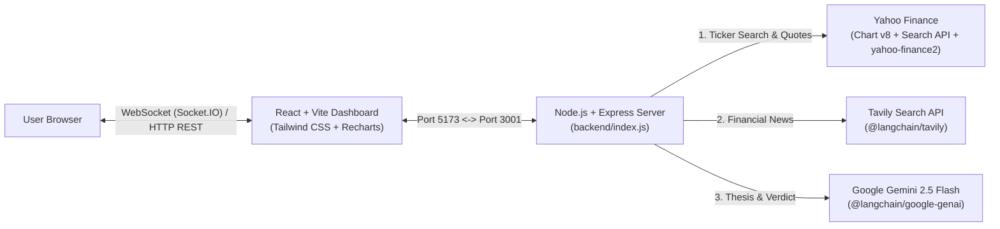
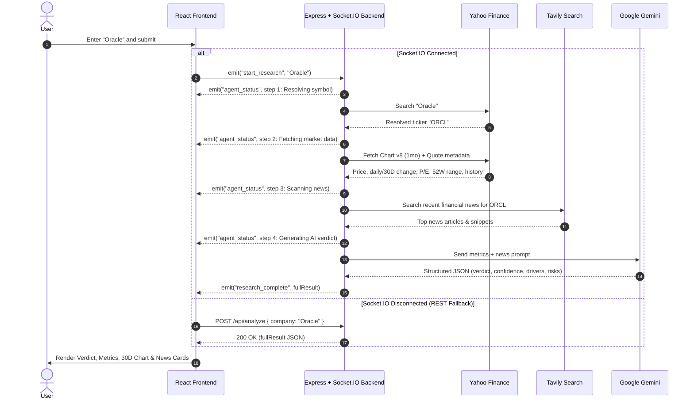
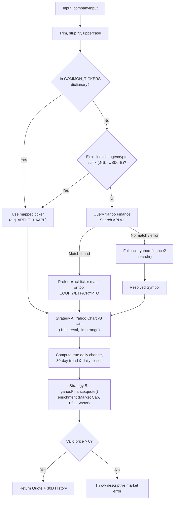
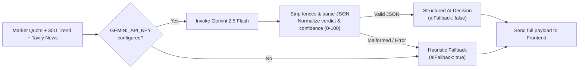

# AI Investment Agent

An end-to-end **AI-powered stock & asset research assistant** that takes any company name or ticker symbol (e.g., `NVDA`, `Apple`, `Oracle`, `Reliance`, `BTC-USD`), pulls **live market data** and **30-day price history** from Yahoo Finance, scans **recent financial news** via Tavily Search, and synthesizes a structured **INVEST**, **HOLD**, or **PASS** verdict using **Google Gemini** — streamed step-by-step to a modern React dashboard.

> **Disclaimer:** This project is for informational and educational research only and does not constitute financial or investment advice.

---

## Table of Contents

- [How It Works at a Glance](#-how-it-works-at-a-glance)
- [System Architecture Diagram](#-system-architecture-diagram)
- [End-to-End Execution Flow](#-end-to-end-execution-flow)
- [Symbol Resolution & Market Data Pipeline](#-symbol-resolution--market-data-pipeline)
- [AI Verdict & Fallback Flow](#-ai-verdict--fallback-flow)
- [Features](#-features)
- [Tech Stack](#-tech-stack)
- [Project Structure](#-project-structure)
- [Quickstart Guide](#-quickstart-guide)
- [API & WebSocket Reference](#-api--websocket-reference)
- [Testing & Quality Checks](#-testing--quality-checks)

---

## How It Works at a Glance

1. **You enter a company name or ticker** in the web dashboard (e.g., `"Boeing"`, `"AAPL"`, or `"BTC-USD"`).
2. **The backend resolves the exact ticker** using a built-in alias dictionary and live Yahoo Finance search.
3. **Live market metrics & 30-day history** are fetched from Yahoo Finance (price, daily change, 30-day trend, market cap, trailing P/E, 52-week range, and daily closes).
4. **Recent news & market sentiment** are retrieved from the web using Tavily Search.
5. **Google Gemini (`gemini-2.5-flash`)** evaluates the metrics + news and outputs a structured JSON verdict (`INVEST`, `HOLD`, or `PASS`), confidence score, rationale, growth drivers, and key risks.
6. **Real-time progress** streams to the UI over Socket.IO (with automatic HTTP REST fallback if WebSockets are unavailable).

---

## System Architecture Diagram



---

## End-to-End Execution Flow

When a user clicks **Analyze Stock** (or picks a quick-pick/recent chip), the frontend prefers a persistent **Socket.IO** connection so it can display live pipeline progress across all 4 stages. If Socket.IO is disconnected, it seamlessly falls back to `POST /api/analyze`.



---

## Symbol Resolution & Market Data Pipeline

Company names of any length (including 1–6 letter names like `Oracle`, `Boeing`, `Pfizer`, or `Ford`) are resolved reliably before fetching market metrics:



---

## AI Verdict & Fallback Flow

To ensure the application never crashes on unexpected LLM formatting or missing API keys, Gemini output passes through a strict sanitizer (`parseAiDecision`):



---

## Features

- **Smart Symbol Resolution**: Search by ticker (`NVDA`, `BTC-USD`, `RELIANCE.NS`) or plain company name (`Apple`, `Oracle`, `Boeing`, `Pfizer`).
- **Live Market Metrics**: Displays current price (multi-currency formatted), today's change, market cap, trailing P/E ratio, and a visual **52-Week Range** position indicator.
- **30-Day Interactive Price Chart**: Responsive Recharts area chart showing daily closes and 30-day percentage performance.
- **Live 4-Step Pipeline Tracker**: Real-time Socket.IO progress card showing each research phase as it completes.
- **AI Verdict & Confidence Score**: Clear `INVEST`, `HOLD`, or `PASS` badge with confidence percentage bar, executive rationale, growth drivers, and key risks.
- **Scanned Financial News**: Displays the live Tavily news headlines and source links factored into the AI analysis.
- **Quick Picks & Recent History**: 1-click popular stock pills plus `localStorage`-persisted recent searches.

---

## Tech Stack

| Layer | Technologies |
| :--- | :--- |
| **Frontend** | React 19, Vite 8, Tailwind CSS v4, Recharts 3, Socket.IO Client |
| **Backend** | Node.js (ESM), Express 5, Socket.IO 4 |
| **Market Data** | Yahoo Finance Chart v8 / Search v1 APIs & `yahoo-finance2` |
| **News & AI** | Tavily Search (`@langchain/tavily`), Google Gemini 2.5 Flash (`@langchain/google-genai`) |
| **Testing & Linting** | Node built-in test runner (`node:test`), ESLint 10 |

---

## Project Structure

```text
ai-investment-agent/
├── backend/
│   ├── tests/
│   │   └── agent.test.js      # Unit tests for symbol resolution, metrics & AI parsing
│   ├── .env.example           # Required backend environment variables template
│   ├── index.js               # Express server, Socket.IO handlers & research pipeline
│   └── package.json           # Backend dependencies and scripts (start, dev, test)
├── frontend/
│   ├── public/
│   │   └── favicon.svg        # Custom SVG app icon
│   ├── src/
│   │   ├── App.jsx            # Main dashboard UI, Socket.IO client & Recharts chart
│   │   ├── index.css          # Tailwind v4 theme, glass card styles & animations
│   │   └── main.jsx           # React root entrypoint
│   ├── .env.example           # Frontend backend-URL configuration template
│   ├── index.html             # HTML shell & Google Fonts
│   └── package.json           # Frontend dependencies and scripts (dev, build, lint)
└── README.md                  # Project documentation & architecture diagrams
```

---

## Quickstart Guide

### Prerequisites

- **Node.js** v18+ (tested on Node 20+ / 26)
- **Google Gemini API Key** ([Google AI Studio](https://aistudio.google.com/))
- **Tavily API Key** ([Tavily](https://tavily.com/))

### 1. Configure & Start the Backend

```bash
cd backend
npm install
cp .env.example .env
```

Edit `backend/.env` with your keys:

```env
GEMINI_API_KEY=your_google_gemini_api_key
TAVILY_API_KEY=your_tavily_search_api_key
PORT=3001
```

Start the backend server:

```bash
npm start
# Or for auto-reload during development:
npm run dev
```

*Backend runs on `http://localhost:3001`.*

### 2. Configure & Start the Frontend

Open a second terminal:

```bash
cd frontend
npm install
cp .env.example .env
npm run dev
```

*Frontend runs on `http://localhost:5173` and connects to `VITE_BACKEND_URL` (`http://localhost:3001` by default).*

---

## API & WebSocket Reference

### REST Endpoints

| Method | Path | Description |
| :--- | :--- | :--- |
| `GET` | `/api/health` | Returns server status, timestamp, and whether Gemini/Tavily keys are configured. |
| `POST` | `/api/analyze` | Accepts `{ "company": "NVDA" }` and returns the full analysis JSON payload. |

### Socket.IO Events

| Direction | Event | Payload |
| :--- | :--- | :--- |
| Client -> Server | `start_research` | Company name/ticker string or `{ company: "..." }` |
| Server -> Client | `agent_status` | `{ step: 1..4, message: "..." }` |
| Server -> Client | `research_complete` | Full analysis object (`symbol`, `price`, `verdict`, `confidence`, `rationale`, `keyDrivers`, `keyRisks`, `news`, `historicalData`, etc.) |
| Server -> Client | `research_error` | `{ message: "..." }` |

---

## Testing & Quality Checks

Run backend unit tests:

```bash
cd backend
npm test
```

Run frontend linter and production build:

```bash
cd frontend
npm run lint
npm run build
```